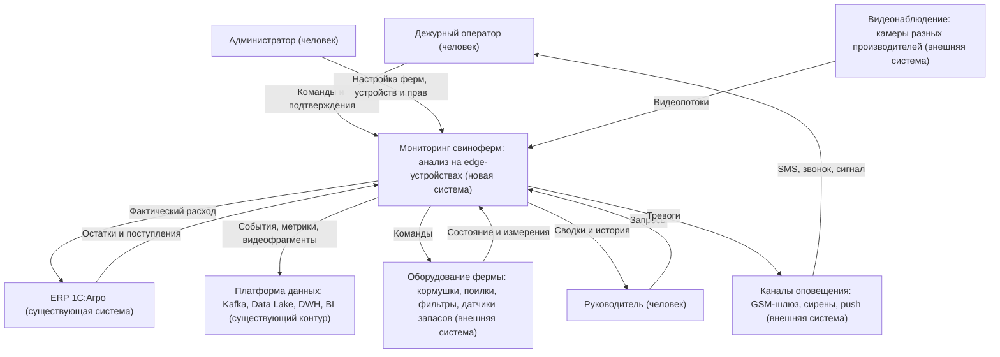
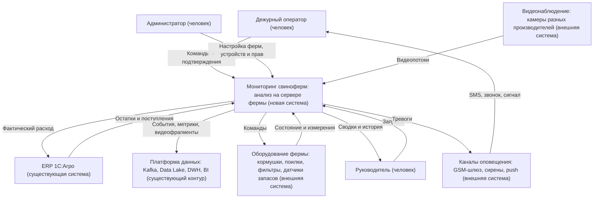

# ADR-001: Система мониторинга свиноферм «АгроТех Х»

**Статус:** ⚠️ На рассмотрении

**Участники:** Представитель бизнеса, сотрудники ферм, разработчики

**Дата:** 2026-10-01

**Связанные решения:** ADR-002, C3/C4, ADR-003

---

## 1. Контекст
Компания хочет автоматизировать работу свиноферм: следить за животными, управлять кормлением и поением, проверять запасы корма и состояние фильтров воды. При опасных ситуациях система должна сообщать сотруднику. Сначала планируется запустить MVP на нескольких фермах.

Готовые продукты (PigVision, ALUS, PigTales) купить и адаптировать не получится из-за ограничений законодательства и стоимости, поэтому платформа разрабатывается с нуля. В перспективе её можно предлагать другим компаниям как SaaS, но это за рамками MVP.

Главная сложность — нестабильный интернет. Ферма должна продолжать работу без связи с головным офисом. Поэтому анализ видео и местные уведомления нужно выполнять на самой ферме, а накопленные данные передавать в центр после восстановления связи.

В компании уже есть ERP, хранилища и BI. Их можно использовать для учёта корма и отчётов. Саму систему наблюдения за животными и агентов для ферм нужно разработать. Готовую модель для анализа видео предоставят партнёры.

Нужно сравнить два варианта: обработку видео на edge-устройствах рядом с камерами и обработку на одном сервере фермы. Это поможет понять объём работ и затем оценить стоимость MVP.

---

## 2. Требования

### Функциональные

**Use Cases**:
| UC-ID | Название                        | Основной поток                                                                                                                                                                                                                 | Альтернативные потоки                                                                                                           |
| ----- | ------------------------------- | ------------------------------------------------------------------------------------------------------------------------------------------------------------------------------------------------------------------------------ | ------------------------------------------------------------------------------------------------------------------------------- |
| UC-01 | Наблюдение за животными         | 1. Камеры передают видео. 2. Система ищет признаки драк, беспокойства, задавливания поросят, болезни или гибели. 3. Сотрудник получает уведомление и проверяет ситуацию.                                                       | Если модель ошиблась, сотрудник отмечает ложное срабатывание.                                                                   |
| UC-02 | Кормление и поение              | 1. Сотрудник задаёт режим работы. 2. Система передаёт команды кормушкам и поилкам. 3. Показывает состояние оборудования.                                                                                                       | Если оборудование не отвечает, система сообщает об этом сотруднику.                                                             |
| UC-03 | Контроль воды и корма           | 1. Система получает показания датчиков и данные о запасах. 2. Проверяет фильтры и остатки корма. 3. Прогнозирует расход и предупреждает о проблемах.                                                                           | Если показания недоступны, сотрудник проверяет состояние на месте.                                                              |
| UC-04 | Подсчёт животных                | 1. Система анализирует видео. 2. Считает животных. 3. Показывает результат сотруднику.                                                                                                                                         | При сомнительном результате сотрудник проверяет количество вручную.                                                             |
| UC-05 | Обмен данными с головным офисом | 1. Агент собирает информацию на ферме. 2. Передаёт её в центр. 3. Центральная система показывает общую информацию.                                                                                                             | При отсутствии интернета агент продолжает местную работу и сохраняет данные. После восстановления связи отправляет накопленное. |
| UC-06 | Просмотр данных                 | 1. Пользователь входит в систему. 2. Получает доступ в соответствии со своей ролью. 3. Просматривает события и показатели своей фермы или всех ферм.                                                                           | Если прав недостаточно, доступ к данным или действиям не предоставляется.                                                       |
| UC-07 | Работа с метриками и API        | 1. Система собирает основные показатели. 2. Позволяет добавлять свои метрики. 3. Передаёт данные через API для веб- и мобильного приложения.                                                                                   | Если источник данных недоступен, система показывает, что показатель не обновлён.                                                |
| UC-08 | Эскалация тревоги               | 1. Система включает тревогу в приложении и световой/звуковой сигнал в помещении. 2. Если сотрудник не подтвердил тревогу за заданное время, оповещение повторяется по SMS или звонком и уходит следующему по графику дежурств. | Если на ферме нет Wi-Fi или интернета, оповещение отправляется через GSM-шлюз, который не зависит от этих каналов.              |

### Нефункциональные
| Категория           | Требование                                                                                                                                      | Критичность |
| ------------------- | ----------------------------------------------------------------------------------------------------------------------------------------------- | ----------- |
| Доступность         | Требуемая доступность — 99,95%. Её нужно проверить при испытаниях.                                                                              | Высокая     |
| Производительность  | От возникновения опасной ситуации до местного уведомления должно проходить не более 5 секунд.                                                   | Высокая     |
| Видеоаналитика      | Анализ должен работать в реальном времени. Требование к реакции в миллисекундах нужно уточнить для готовой модели.                              | Высокая     |
| Синхронизация       | При нормальной связи задержка обмена с центральной системой — не более 10 минут.                                                                | Высокая     |
| Автономность        | Без интернета должны работать анализ видео, управление оборудованием и местные уведомления.                                                     | Высокая     |
| Расширяемость       | Нужно предусмотреть добавление функций, камер и агентов без фиксированного ограничения их количества.                                           | Высокая     |
| Совместимость       | Поддержка камер, кормушек и поилок разных производителей через адаптеры.                                                                        | Высокая     |
| Безопасность        | Разделение ролей, современные способы входа и проверка прав доступа.                                                                            | Высокая     |
| Инфраструктура      | На ферме допускаются один сервер и необходимое количество edge-устройств. Для камер желательно проводное подключение из-за нестабильного Wi-Fi. | Высокая     |
| Каналы связи        | Основной канал с центром и резервный (LTE). Тревоги дежурному — через GSM (SMS, звонок) и сигнал в помещении, независимо от интернета и Wi-Fi.  | Высокая     |
| Персональные данные | В кадр попадают сотрудники: нужны сроки хранения видео, ограничение доступа к записям и соблюдение законодательства о персональных данных.      | Средняя     |

---

## 3. Решение

### Описание
Основной вариант — анализировать видео на edge-устройствах. Это небольшие вычислительные устройства рядом с камерами на ферме. Они запускают готовую модель, находят опасные ситуации и отправляют уведомление сотруднику.

Сервер фермы собирает результаты, хранит данные и передаёт их в головной офис. При отсутствии интернета данные временно остаются на ферме. Для сотрудника нужен местный интерфейс, доступный без интернета.

Важно, чтобы отправка тревог с edge-устройств не зависела от сервера фермы. Для этого при недоступности сервера edge-устройство отправляет тревогу напрямую через GSM-шлюз (SMS, звонок, сирена). Тогда при отказе сервера анализ и местные уведомления продолжают работать.

**Контекстная диаграмма C4 C1 — основной вариант:**

На схеме новая платформа показана одной системой. В неё входят центральная часть, серверы ферм и edge-устройства. Камеры и оборудование показаны как внешние системы, с которыми она взаимодействует.

**Что потребуется разработать:**

| Где             | Что добавить                                                                      |
| --------------- | --------------------------------------------------------------------------------- |
| Головной офис   | Приём данных от ферм, просмотр событий, настройки, роли пользователей и API.      |
| Сервер фермы    | Сбор и хранение данных, местный интерфейс, обмен с головным офисом.               |
| Edge-устройства | Анализ видео, обнаружение событий и местные уведомления.                          |
| Ферма           | Подключение кормушек, поилок и датчиков через адаптеры для разных производителей. |
| Ферма           | GSM-шлюз и сирены для оповещений без интернета; резервный канал связи (LTE).      |

Из существующих систем используем ERP для сведений о запасах и расходе корма. Корпоративная шина данных, хранилища и BI пригодятся для передачи показателей и отчётов. На схеме они объединены в блок «Платформа данных». Для них потребуется добавить интеграцию с новой платформой.

Тепличные системы и мониторинг техники напрямую в этот MVP не входят.

### Аргументация

| Критерий                     | Обоснование                                                                                                                                      |
| ---------------------------- | ------------------------------------------------------------------------------------------------------------------------------------------------ |
| Работа без интернета         | Видео обрабатывается на ферме, поэтому связь с головным офисом не нужна для местных уведомлений.                                                 |
| Устойчивость к отказам       | Обработка распределена между устройствами. Отказ сервера фермы не должен останавливать все тревоги.                                              |
| Время оповещения             | Путь тревоги замкнут внутри фермы: событие обнаруживается рядом с камерой, оповещение не зависит от центра — это позволяет уложиться в 5 секунд. |
| Добавление камер             | При необходимости можно добавлять edge-устройства вместе с камерами.                                                                             |
| Использование текущих систем | ERP и системы отчётности можно связать с новой платформой.                                                                                       |
| Компромисс                   | Основной вариант сложнее в настройке и требует больше устройств, зато меньше зависит от одного сервера.                                          |

#### Последствия

**✅ Положительные:**
- Ферма продолжает анализ видео и отправку местных уведомлений без интернета.
- Обработка распределена между несколькими устройствами.
- В головном офисе можно собирать общие показатели по фермам.

**⚠️ Негативные:**
- Нужно купить и настроить edge-устройства.
- Поддерживать несколько устройств и обновлять на них модель сложнее, чем один сервер.
- При отсутствии связи информация в головном офисе будет обновляться с задержкой.

**↗️ Зависимости:**
- Готовая модель от партнёров и её совместимость с выбранными устройствами.
- Камеры с ночной съёмкой, достаточное покрытие помещений и работающая местная сеть.
- Возможность подключения оборудования, ERP и систем отчётности.

---

### 4. Альтернативы

| Вариант                             | Плюсы                                                                                         | Минусы                                                                                           | Почему отклонен                                                                                                                                           |
| ----------------------------------- | --------------------------------------------------------------------------------------------- | ------------------------------------------------------------------------------------------------ | --------------------------------------------------------------------------------------------------------------------------------------------------------- |
| Анализ видео на одном сервере фермы | Проще собрать первую версию: основная логика находится в одном месте. Работает без интернета. | Нужен достаточно мощный сервер. Его отказ останавливает видеоаналитику и уведомления всей фермы. | Пока не выбран основным из-за зависимости от одного сервера. Можно вернуться к нему, если испытания подтвердят нужную доступность и приемлемую стоимость. |

В этом варианте камеры передают видео на сервер фермы. Он запускает модель, управляет оборудованием и сообщает сотруднику о событиях. Информация также отправляется в головной офис. Edge-устройства для анализа видео не требуются, но могут понадобиться простые шлюзы для подключения оборудования.

**Контекстная диаграмма C4 C1 — альтернативный вариант:**

Внешние системы те же, поэтому контекстные схемы похожи. Главное отличие — место обработки видео. Первый вариант требует больше устройств и настроек. Второй проще для старта, но сильнее зависит от единственного сервера фермы. Итоговую стоимость нужно сравнить после уточнения количества камер и оборудования.

---

### 5. Риски

1. **Ошибки модели и недостаточное качество видео**
   Модель может принимать тень за животное, а плохое освещение или слепые зоны мешают обнаруживать события.
   *Меры:* Проверить модель на дневных и ночных записях, подобрать расположение камер. Важные события должен проверять сотрудник. Ошибки с тенями допускаются для MVP.

2. **Потеря связи и переполнение местного хранилища**
   При долгом отсутствии интернета данные будут накапливаться на ферме.
   *Меры:* Определить срок хранения, предусмотреть местные уведомления и проверить отправку накопленных данных после восстановления связи.

3. **Отказ оборудования и неподтверждённая производительность**
   Edge-устройство может перестать обрабатывать свою зону, а в альтернативном варианте отказ одного сервера остановит анализ всей фермы. Пока нельзя считать доступность 99,95% и задержку до 5 секунд подтверждёнными.
   *Меры:* На пилоте проверить работу нескольких камер, отказ устройств, восстановление и скорость местных уведомлений. Для оценки стоимости уточнить количество камер и список оборудования.

4. **Нестабильная сеть внутри фермы**
   Wi-Fi на ферме ненадёжен: уведомления в приложение и данные с устройств могут теряться.
   *Меры:* Проводное подключение камер и edge-устройств, точки доступа с перекрытием зон, сигнал в помещении и GSM как резервный канал тревог, подтверждение получения тревоги сотрудником.

5. **Несовместимость оборудования разных производителей**
   Камеры, кормушки и поилки поддерживают разные протоколы, часть — закрытые.
   *Меры:* Составить список совместимого оборудования для пилотных ферм, подключать его через адаптеры, проверить протоколы до закупки.
