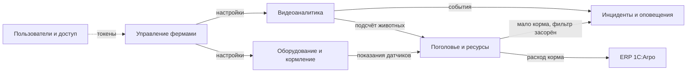

# ADR-002: Ограниченные контексты, контейнеры и интеграции

**Статус:** ⚠️ На рассмотрении

**Участники:** Представитель бизнеса, архитектор, разработчики

**Дата:** 2026-10-01

**Связанные решения:** ADR-001

---

## 1. Контекст

В ADR-001 описаны два варианта платформы мониторинга свиноферм:

- **A** — видео анализируется на edge-устройствах рядом с камерами;
- **B** — видео анализируется на одном сервере фермы.

Теперь нужно разбить систему на ограниченные контексты, чтобы по ним выделить микросервисы, показать контейнеры для обоих вариантов (C2) и выбрать способы интеграции.

В компании уже есть ERP 1С:Агро, Kafka, DWH и BI. Их переиспользуем, новые технологии добавляем только там, где без них не обойтись.

---

## 2. Требования

Функциональные требования — UC-01…UC-08 из ADR-001. Для этого решения важнее всего нефункциональные:

| Требование                         | Что это значит для архитектуры                                     | Критичность |
| ---------------------------------- | ------------------------------------------------------------------ | ----------- |
| Оповещение не позднее 5 с          | Путь «событие → тревога» должен быть целиком на ферме, без центра  | Высокая     |
| Работа без интернета               | На ферме своя БД; данные копятся и отправляются в центр позже      | Высокая     |
| Синхронизация с центром до 10 мин  | Ферма отправляет данные пакетами раз в 1–5 минут                   | Высокая     |
| Доступность 99,95 %                | Тревоги не должны зависеть от одного узла                          | Высокая     |
| Оборудование разных производителей | Подключение через адаптеры                                         | Высокая     |
| Неограниченное число ферм          | Центр масштабируется горизонтально, фермы независимы друг от друга | Средняя     |

---

## 3. Решение

### 3.1. Ограниченные контексты

| #   | Контекст                     | За что отвечает                                                                                              | Сервисы                                                                          |
| --- | ---------------------------- | ------------------------------------------------------------------------------------------------------------ | -------------------------------------------------------------------------------- |
| 1   | **Видеоаналитика**           | Обработка видео моделью партнёра: драки, задавливание, болезнь, гибель, подсчёт                              | A: ПО edge-устройства; B: сервис видеоаналитики на сервере фермы                 |
| 2   | **Инциденты и оповещения**   | Превращает события в тревоги, оповещает дежурного, эскалирует, учитывает подтверждения и ложные срабатывания | Сервис инцидентов и оповещений (ферма)                                           |
| 3   | **Оборудование и кормление** | Кормушки, поилки, датчики разных производителей; расписания кормления                                        | Сервис оборудования (ферма)                                                      |
| 4   | **Поголовье и ресурсы**      | Численность и здоровье животных, запасы корма, фильтры воды, прогноз расхода                                 | Сервис поголовья и ресурсов (ферма), сервис мониторинга ферм (центр)             |
| 5   | **Управление фермами**       | Список ферм и устройств, настройки, обмен данными ферма ↔ центр                                              | Сервис синхронизации (ферма), сервисы приёма данных и управления фермами (центр) |
| 6   | **Пользователи и доступ**    | Вход, роли, доступ к фермам                                                                                  | Keycloak (готовый продукт)                                                       |

Как контексты связаны:

**Компромиссы и риски по контекстам:**

| Контекст                 | Компромисс                                                                        | Риск и мера                                                                                                 |
| ------------------------ | --------------------------------------------------------------------------------- | ----------------------------------------------------------------------------------------------------------- |
| Видеоаналитика           | Зависим от модели партнёра, её выходы переводим в свой формат события             | Модель ошибается (тени, ночь). *Мера:* проверить на дневных и ночных записях, отметка «ложное срабатывание» |
| Инциденты и оповещения   | Отдельный сервис — на один шаг больше, но тревоги не смешиваются с другой логикой | Шторм одинаковых тревог. *Мера:* объединять события одной зоны за короткий интервал                         |
| Оборудование и кормление | Один сервис с адаптерами вместо сервиса на каждого производителя                  | Ошибка адаптера влияет на всё оборудование. *Мера:* тесты адаптеров, перезапуск сервиса                     |
| Поголовье и ресурсы      | Поголовье и ресурсы в одном сервисе — проще для MVP, позже можно разделить        | Сервис разрастается. *Мера:* разделить, когда появится отдельная команда                                    |
| Управление фермами       | Пишем свой простой сервис синхронизации                                           | Потеря или дубли данных при обрывах. *Мера:* отправка с подтверждением, уникальный id события               |
| Пользователи и доступ    | Готовый Keycloak вместо своей разработки                                          | Без интернета нельзя войти через центр. *Мера:* локальные учётные записи для дежурных                       |

### 3.2. Диаграммы контейнеров (C2)

Центральная платформа и сервисы фермы в обоих вариантах одинаковые. Отличается только место анализа видео.

#### Вариант A — анализ на edge-устройствах

ПО edge-устройства анализирует видео своих камер и отправляет события в брокер на сервере фермы. Если сервер недоступен, edge-устройство отправляет тревогу напрямую в GSM-шлюз.

#### Вариант B — анализ на сервере фермы

Все камеры подключены к серверу фермы с GPU, на нём работает сервис видеоаналитики. Если сервер перестаёт отвечать, GSM-шлюз сам отправляет SMS «сервер недоступен», но тревоги о событиях в это время не формируются.

| Критерий                 | A                                         | B                                     |
| ------------------------ | ----------------------------------------- | ------------------------------------- |
| Отказ сервера фермы      | Тревоги продолжают уходить через GSM      | Видеоанализ и тревоги останавливаются |
| Добавление камер         | Новое edge-устройство на каждые 4–8 камер | Ограничено мощностью одного сервера   |
| Нагрузка на сеть фермы   | По сети идут только события               | По сети идёт видео со всех камер      |
| Стоимость и обслуживание | Дороже, много устройств                   | Дешевле, один сервер                  |

### 3.3. Интеграции

| Откуда → куда                      | Как                                                                                     | Почему                                                               | Компромисс                                                               |
| ---------------------------------- | --------------------------------------------------------------------------------------- | -------------------------------------------------------------------- | ------------------------------------------------------------------------ |
| Камеры → видеоаналитика            | RTSP / ONVIF, проводная сеть                                                            | Стандарт, поддерживается большинством производителей                 | Не все камеры одинаково поддерживают ONVIF — нужен список совместимых    |
| Видеоаналитика → сервисы фермы     | Через брокер RabbitMQ (MQTT для edge, AMQP для сервисов)                                | Асинхронно: событие не теряется, если сервис занят                   | Возможны повторные доставки — сервисы проверяют id события               |
| Оборудование → сервис оборудования | Modbus, OPC UA, REST через адаптеры                                                     | У производителей разные протоколы                                    | Новый производитель — новый адаптер                                      |
| Тревоги → дежурный                 | Приложение (WebSocket), сирена и SMS/звонок через GSM-шлюз                              | GSM работает без интернета и Wi-Fi                                   | SMS может прийти позже 5 с, поэтому основной канал — приложение и сирена |
| Ферма → центр                      | Сервис синхронизации отправляет пакеты по HTTPS раз в 1–5 мин                           | Проходит через любую сеть, включая LTE; задержка до 10 мин допустима | Нужно повторять отправку после обрыва и не создавать дублей              |
| Центр → ферма (настройки)          | Ферма сама запрашивает настройки по HTTPS                                               | Ферма за NAT и не всегда на связи                                    | Изменения доходят с задержкой                                            |
| Центр → корпоративная платформа    | Существующая Kafka                                                                      | Уже есть в компании, к ней подключены DWH и BI                       | Зависим от общей корпоративной инфраструктуры                            |
| Центр ↔ ERP 1С                     | REST / OData 1С                                                                         | Штатный механизм 1С, ERP менять не нужно                             | Данные о запасах обновляются с задержкой                                 |
| Клиенты → центр                    | REST + WebSocket через API Gateway, вход через Keycloak (OIDC)                          | Привычный стек для веб- и мобильного приложения                      | —                                                                        |
| Метрики                            | Сервисы отдают метрики в формате Prometheus, ферма передаёт их в центр вместе с данными | Стандартный формат, его понимают другие системы                      | Свои метрики добавляются через настройки, без изменения кода             |

**Выбор брокера на ферме — RabbitMQ.**

Преимущества:

- MQTT-плагин позволяет подключать edge-устройства и часть оборудования без отдельного MQTT-брокера;
- распространённая технология, легко найти специалистов;
- нетребователен к ресурсам — помещается на сервер фермы;
- поддерживает кластеризацию, если на ферме появится второй сервер.

Ограничение: при большой нагрузке и необходимости долго хранить поток событий лучше подходит Kafka. Поэтому на ферме RabbitMQ, а в центре используем уже существующую Kafka для передачи данных в DWH и BI.

#### Последствия

**✅ Положительные:**

- Тревоги формируются на ферме и не зависят от интернета.
- Сервисы фермы и центра одинаковы в обоих вариантах — меняется только видеоаналитика.
- Используем существующие Kafka, ERP и BI.

**⚠️ Негативные:**

- Нужно написать свой сервис синхронизации.
- Данные в центре отстают от фермы на несколько минут.

**↗️ Зависимости:**

- Модель партнёра и её работа на выбранном оборудовании.
- Протоколы и документация оборудования производителей.

---

### 4. Альтернативы

| Вариант                                      | Плюсы                           | Минусы                                    | Почему отклонен                                   |
| -------------------------------------------- | ------------------------------- | ----------------------------------------- | ------------------------------------------------- |
| Kafka на каждой ферме                        | Одна технология с центром       | Тяжела для одного сервера, нет MQTT       | Избыточна для нагрузки фермы                      |
| Отдельный MQTT-брокер (Mosquitto) + RabbitMQ | Полная поддержка MQTT           | Два брокера на ферме                      | Плагина MQTT в RabbitMQ достаточно                |
| Анализ видео в облаке                        | Не нужно мощное железо на ферме | Нужен стабильный интернет и широкий канал | Не выполняются требования автономности и 5 секунд |
| Отдельный сервис на каждую функцию фермы     | Независимые выпуски             | Больше сервисов для небольшой команды     | Для MVP достаточно трёх сервисов на ферме         |

---

### 5. Риски

1. **Ложные срабатывания модели**
   *Меры:* проверка на реальных записях, отметка оператором, дообучение модели партнёром.

2. **Долгое отсутствие связи с центром**
   *Меры:* срок хранения данных на ферме, предупреждение «нет связи с центром», досылка после восстановления.

3. **Отказ сервера фермы**
   *Меры:* ИБП, сигнал «сервер работает» в GSM-шлюз; в варианте A — отправка тревог с edge напрямую.

4. **Несовместимое оборудование**
   *Меры:* список проверенного оборудования для пилотных ферм.
